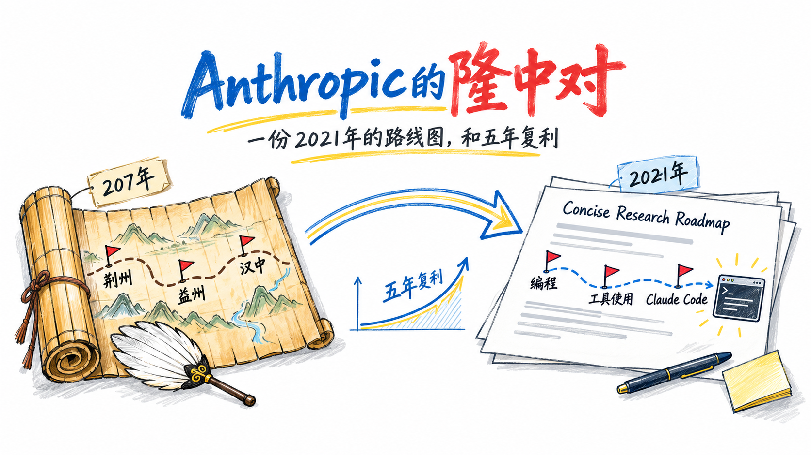
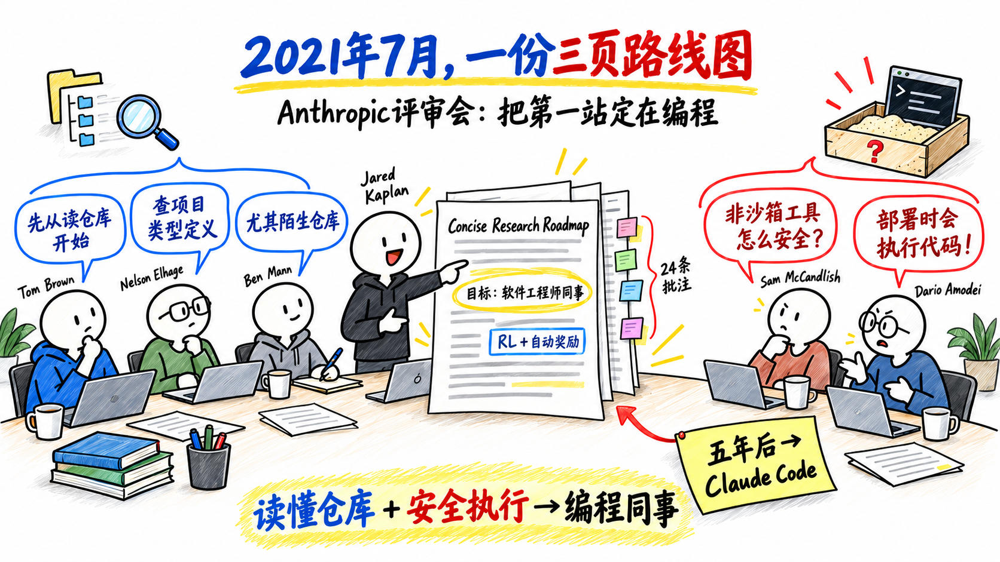
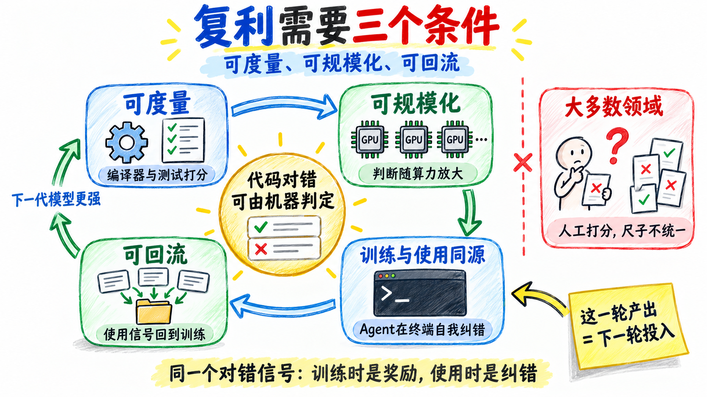
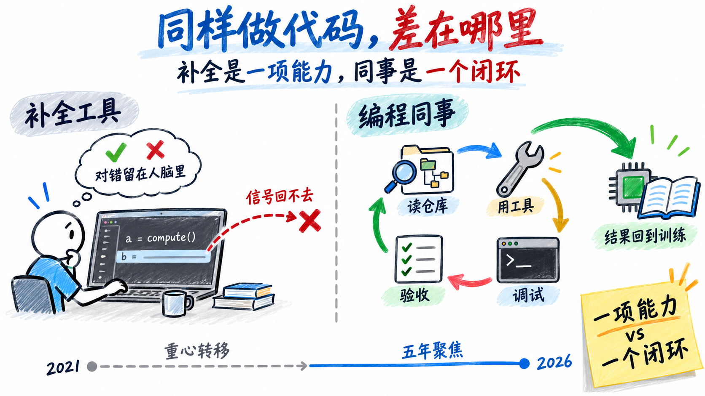
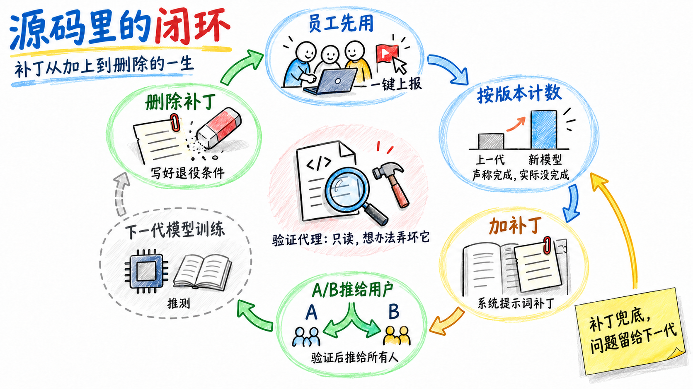

# Anthropic的隆中对：一份2021年的路线图，和五年复利

**选一个对错能被机器判定的领域，然后在里面待五年**

Oct 15, 2026 · @kvenux

2026年10月中旬，X上流传起一份Anthropic的内部文档。标题叫《Concise Research Roadmap》，联合创始人Jared Kaplan执笔，正文三页，后面附着Dario Amodei、Tom Brown等十几个人的24条批注。它随Bartz诉Anthropic版权案进入法院案卷，一直躺在那里，直到最近被翻出来。

真正让人停下来的，是它的成文时间：2021年7月。

那时GPT-3的上下文窗口只有2048个token；最强的代码模型Codex在HumanEval上只能解对28.8%的题；GitHub Copilot刚开放预览，AI写代码还停在补全下一行。成立不到半年、还没有任何产品的Anthropic，在这个时间点把通向AGI的第一站，定为一个具备**all the capabilities of a software engineer colleague**的助手。评审批注里，Dario已经在担心**tools that execute code at deployment time**，而当时市面上还没有任何agent产品。

五年后，路线图上的条目一项项成了现实。Claude Code在陌生代码库里自己搜索、修改、运行代码，每条命令执行前先做权限检查；Opus 5.5在终端编程评测Terminal-Bench 4.0上拿到66.4%，领先同期竞品。X上的评论大多是同一句话：**2021年就全知道了。**

我觉得"全知道了"这个解释不够。在2021年押注AI编程的人不少，看对一个方向并不难，难的是五年里执行不走样。所以更值得问的是：这份路线图凭什么能一路兑现？

先说结论：

> **Anthropic押对的不是"AI会写代码"，而是"代码的对错能被机器判定"。同一个对错信号，训练时是奖励，使用时是Agent自我纠错的依据；用得越多，回流给下一代模型的信号就越多。五年的投入都围绕这一个闭环展开，这才是复利的来源。**

## 一、三页纸里写了什么

路线图分两部分：Jared Kaplan写的正文，定目标和手段；7月16日下午评审会上的24条批注，补充了团队对具体问题的预判。

### 正文：目标与手段

- **长期目标**：**safe, beneficial AGI**。
- **主要目标**：作为proof of concept，做出**a general AI assistant that can interact conversationally with a user to create, edit, and explain software**，最理想的版本具备**all the capabilities of a software engineer colleague**。文档承认短期内做不到，但所有研究项目都被看作在构建这个**proto-AGI**的某个侧面。
- **实现路径**：**large generative models with long memories, fine tuned via RL using both automated rewards and human feedback**。
- **具体手段**：
  - **数据**：预训练language+code模型，研究**1T and larger**规模的训练；数据集覆盖code、diffs、PRs、debugging和对应的code evaluations；用Diffs、PRs、Wikidiffs微调，**connect human intentionality to model behavior**。Dario在批注里补了一句**stackoverflow, issues, comments**。
  - **工具使用**：用RL训练模型使用工具，先在**search, printf debugging**上看到**clear signs of life**；寻找**more favorable scaling with training compute as compared to supervised learning**的训练方法。
  - **算力**：提前**de-risk future hardware such as TPUs, Trainium**，**prepare for compute deals**。

### 批注：两个预判，一个排序

1. **编程助手的第一个能力，是读懂陌生代码库。**Tom Brown认为**repository browsing**是最好的起点；Nelson Elhage说，如果只能给Copilot加一个能力，就是**go look up my project's type definitions**；Ben Mann补充，**especially for a repo you've never seen before**。
2. **Agent的头号难题，是执行代码的安全。**Sam McCandlish问**how to deploy non-sandboxed tools safely?**，Dario补充**tools that execute code at deployment time**。
3. **短期和长期的先后顺序。**Andy Jones指出这里有一个张力：要做**the best coprogrammer**，读仓库是最好的起点；要**convincingly demo tool use**，printf调试加编辑器的效果远胜读仓库。Dario的回答是：**prioritize the latter in the short run and the former in the long run.** 短期先证明工具使用可行，长期做最好的编程搭档。

还有一条批注不在编程本身，却同样指向"统一"。Amanda Askell担心，如果对齐研究做在自然语言上、能力研究做在代码上，对齐会变成一座孤岛：能力不在同一个领域提升，对齐就测不充分。她提出的原则是，能力研究和对齐研究默认应在同一批领域里同步推进。

这些批注说明，路线图不只定了方向，还在评审当天就排好了先后顺序。五年后回头看，这个顺序基本没变：先在search、printf debugging这类短任务上练出工具使用，再走向能读懂陌生仓库的编程同事。

单看这些条目，很容易读成一份"预言清单"。但把它们放在一起看，会发现它们不是并列的愿望，而是围绕同一个机制排出来的。

## 二、复利需要什么条件

"复利"这个词常被用得很虚，先把它拆到底。

复利的意思是：这一轮的产出，变成下一轮的投入。放在模型公司身上，就是这一代模型做出来的东西，能成为训练下一代的燃料。要做到这一点，需要三个条件：

1. **可度量**：能判断模型有没有变好。
2. **可规模化**：判断的成本足够低，能跟着算力一起放大。
3. **可回流**：使用中持续产生新的判断，并且这些判断能回到训练里。

第三个条件其实是两步：使用时也要能判断对错；判断的结果还要回得去。

大多数领域里，这三件事是断开的。训练靠人工打分，用户满不满意是另一套标准，两者之间没有一把统一的尺子。代码不一样。编译器、测试、终端输出，天然给了前两样，也给第三样打好了地基。

回头看路线图，它正是沿着这三个条件落地的。

### 可度量：为什么第一站是coding

复利的前提，是知道自己有没有变好。路线图的实现路径里写着automated rewards，代码正好满足：能不能编译、测试过不过，由机器判定，模型在编程上的每一点进步都能被量化。

选coding作为第一站，表面上看是选了一个商业前景好的场景，实际上是选了一个反馈信号最干净的场景。

### 可规模化：让判断跟着算力走

人工标注的速度跟不上算力增长，机器判定可以。对错能由机器判定，多投入的算力才能稳定地转化成能力，而不是卡在标注产能上。路线图要找**more favorable scaling with training compute as compared to supervised learning**的训练方法，说的就是这件事。

有了这个前提，算力才值得提前布局。路线图按**1T and larger**的规模做准备，而当时引发轰动的GPT-3是1750亿参数；它还要提前de-risk TPU和Trainium，后来Anthropic与谷歌、亚马逊的大规模算力合作，用的正是这两种芯片。

这里有一个容易被忽略的顺序：不是先有算力再找方向，而是先确定了一个能吃下算力的反馈机制，算力投入才有意义。

### 训练与使用同源：Agent在终端里工作

模型变强之后，还要让它在使用中拿到同一种对错信号。

路线图让工具使用从search和printf debugging练起，批注把读懂陌生代码库列为第一个能力。这些事，程序员都在终端里完成。Claude Code选了命令行工具的形态，在终端里搜索、修改、运行代码。命令成没成功、测试过没过，结果都写在输出里。

于是，训练时用来打分的对错，到了使用时，成了Agent自我纠错的依据。训练环境和使用环境是同一个环境，这是代码这个领域最特殊的地方。

### 可回流：用户敢用，信号才回得去

回流的前提是用户敢用。Agent要在用户的机器上执行命令，这正是2021年批注里Sam和Dario列为头号难题的事。Claude Code执行每条命令前都做权限检查，个人和企业才敢让它在自己的机器上跑。

所以权限检查不只是安全功能，它也是闭环的一环：没有它，就没有规模化的使用；没有规模化的使用，就没有回流。

使用有了规模，信号才能回来。2025年8月，Anthropic更新了个人用户条款：用户同意后，新的对话和Claude Code编程会话可以用于训练模型，理由之一是让未来的模型更擅长编程。真实任务里的对错，回到了下一代模型的训练中。

三个条件都满足，闭环才转得起来。2022年底ChatGPT把行业焦点拉向对话产品，Anthropic也推出了claude.ai，但模型迭代的重心一直留在编程上。五年的投入都压在这一个闭环里，每一代模型都站在上一代的使用之上。这就是复利。

### 同样做代码，为什么是Anthropic

一个自然的问题：OpenAI在2021年7月就发布了Codex，GitHub Copilot也基于它，在代码领域起步更早。为什么复利的故事落在了Anthropic身上？

核心差别不在谁先做代码，而在做成了什么。Codex证明了模型能写代码，Copilot把它做成了编辑器里的补全：人写一行，模型补一行。这个形态里，对错由人在编辑器里默默判断，信号留在人的脑子里。Anthropic的路线图从一开始瞄准的是一个能独立干活的同事：会用工具、读仓库、调试、验收，干活的结果再回到训练里。前者是一项能力，后者是一个能自我强化的闭环。

另一个差别是聚焦。此后几年，OpenAI的重心转向ChatGPT、GPT-4和多模态，Codex模型在2023年停止对外提供，直到2025年才推出新的Codex Agent。Anthropic五年都押在coding上。今天两家的差距已经在缩小，新版Codex在部分评测上追平甚至反超；但Claude Code的先发，是这五年聚焦的结果。

## 三、源码里的闭环

上面是从路线图往下推。反过来，也能从产品往上看。2026年3月泄露的Claude Code源码里，这个闭环在产品一侧处处可见：Agent在用户机器上用同一种对错自我验收，问题按模型版本度量，使用中的信号被系统地收集，并给下一代模型留好了接口。

先交代三个概念。Claude Code每次运行，都会先给模型一段很长的工作说明，也就是系统提示词，告诉它该怎么读代码、怎么改、怎么汇报。模型训练好以后，团队要修正它的某个行为，最快的办法是在这段说明里加一段针对性的要求，下文称为**补丁**。源码里，这些补丁旁边留着开发者的**注释**，写明为什么加、什么时候删。

### Agent自己验收

内部版本里，和用户对话的主代理可以调用另一个模型实例作为验证代理。验证代理只能读、不能改，任务是想办法把刚完成的实现弄坏。它判定通过，必须附上实际运行的命令输出；较大的改动要先过它这一关，主代理才能向用户报告完成。

验证代理依赖的，正是训练时automated rewards依赖的那种信号：命令输出和测试结果。

### 员工先用

代码库里有几十处标记，标出每次换上新模型时必须检查和更新的地方，比如默认模型、上下文长度、是否开放自动模式。新模型上线后，最先用它的是Anthropic自己的员工。

Claude Code会判断用户是不是Anthropic员工，员工和外部用户拿到的是两套不同的系统提示词，新补丁先只放进员工那一套。员工遇到奇怪输出、选错工具、幻觉或拒绝，可以一键上报，也可以一键上传整段会话；员工表现出挫败情绪，系统也会记下来。外部用户的版本里没有这些功能。

### 按版本计数

源码注释记录，团队按模型版本测量同一种失败：声称完成，实际没完成，新模型要和上一代对比。员工的上报怎样汇总成这类指标，源码里看不全，但测量本身是确定的。

这个比例上升了，团队就在系统提示词里加一段补丁，要求模型如实报告：测试失败就贴出输出，不许压掉失败的检查来换取通过。提示词的其他修改也一样，注释里记着每次改动对应的假设和评测结果。

### 补丁推给用户

补丁在员工中验证有效后，再做A/B测试：一部分外部用户用加了补丁的版本，一部分用原版，比较效果，确认后推给所有人。

外部用户这一侧同样在被度量。会话按完成程度分类，摩擦被归为误解需求、方法错误、代码有bug等类型；用户说一句**keep going**也会被记下来，那是模型停得太早的信号。用户同意后，编程会话可以用于训练；用户主动分享的会话，按差评、好评、挫败打上标签。

### 补丁写好退役条件

补丁并不打算永久保留。源码里，补丁旁的注释写着退役条件：**等模型默认不再这样，就删掉**、**下一代模型发布时删除这一段**。补丁先替当前模型兜底，问题留给下一代模型在训练中解决，到那时补丁就可以删除，循环回到起点。

这些会话和问题怎样进入训练，源码里看不到。合理的推测是：带标签的失败会话，和补丁记录的已知问题，就是下一代模型的训练目标；补丁被删除的时候，问题已经被模型吸收。这一步是推测，不是源码能证明的事实。

## 四、这个判断的边界

"选一个可验证的领域，然后形成闭环"，这个判断有几个边界，不说清楚就容易变成事后诸葛亮式的神话。

**第一，可验证不是代码独有的。**数学、形式化证明、部分科学计算，对错同样能由机器判定。代码的特殊之处在于两件事同时成立：既有干净的验证信号，又有巨大的真实使用量。只有前者，闭环转不起来；只有后者，信号是脏的。

**第二，测试通过不等于需求满足。**机器能判定的只是对错的一部分。误解需求、设计取舍、该不该做这件事，仍然要靠人。源码里专门测量"声称完成，实际没完成"，本身就说明这把尺子有漏洞，模型会学着去钻它。

**第三，闭环本身不是护城河。**用可验证奖励做RL，2024年之后已经是行业共识，各家都在走这条路；新版Codex在部分评测上已经追平甚至反超。先发能转化成多少长期优势，取决于回流数据的规模、质量和独占性，而这些从外部都看不到。

**第四，文中关于回流的部分有推测成分。**路线图是一手材料，用户条款是公开事实，源码里的度量和补丁机制是可见的；但信号如何进入训练、对模型提升贡献多大，外部无法验证。

## 结语：从隆中对到汉中王

207年，寄居新野、无地无兵的刘备，从诸葛亮那里得到一条路径：先取荆州、益州，再图天下。十二年后，他据有荆益，自立为汉中王。每一步都建在上一步的地盘上：有了荆州，才有入蜀的本钱；有了益州，才能北争汉中。

Anthropic的五年也是这样，每一代模型都建在上一代的使用之上。2021年的三页纸，就是它的隆中对。

这和外界对这家公司的印象很不一样。在不少人眼里，Anthropic有点像一家神棍公司：X上常有人叫它末日教，员工被描述成一群高智商的doomer；Dario被批评高高在上，一边警告AI可能带来灾难，一边做最强的模型、拿最多的融资。这些批评有它的来由。可同一家公司，又用五年时间执行一份三页纸的规划，从数据、算力到产品，几乎没有偏离。

被叫作神棍，某种程度上是长期主义的代价。按五年后的终点做规划，在当下的旁观者看来，难免像在说胡话。但Anthropic能坚持下来，靠的不只是信念。路线图把第一站放在一个对错能被检验的领域，每走一步，都知道自己有没有走对。外界怎么评价，改变不了测量的结果。

这件事对个人同样成立。定一个长期目标不难，难的是在没有掌声的阶段继续投入。真正让人坚持下来的，往往不是意志力，而是一把能检验进展的尺子：一个被真实使用的产品，一个能反复打磨的作品，一项能用结果衡量的技能。有了这把尺子，短期的喧嚣只是噪音，每一次投入都能留下来，成为下一轮的起点。

所以我从这份路线图里读到的，不是"他们早就知道"，而是一个更朴素的做法：**先找到一个能判断对错的地方，再在里面待足够久。**
